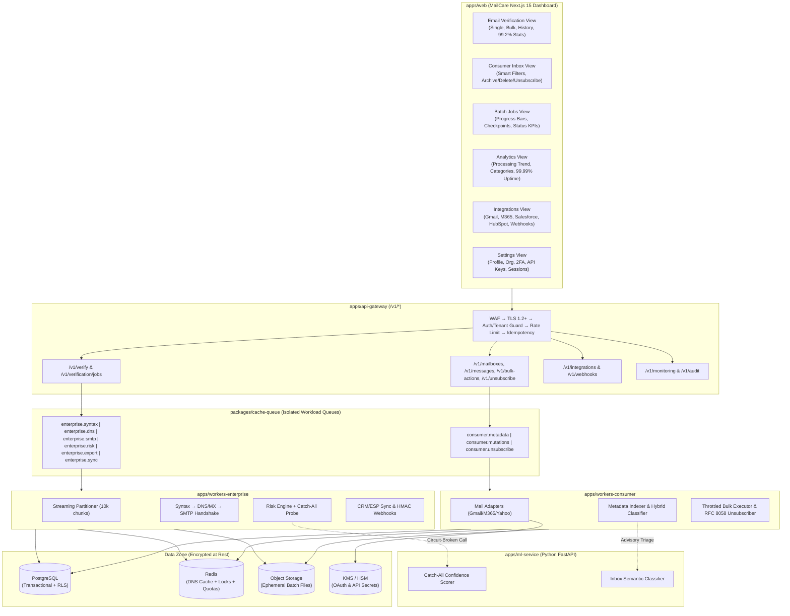

# MailCare — Project Directory Tree & Architecture Structure

**Platform:** Email Cleaning & Data Hygiene Platform (*Consumer Inbox Manager + Enterprise B2B Email Verification*)  
**Architecture Style:** Cloud-Native, API-First, Event-Driven, Multi-Tenant Monorepo  
**Reference Documents:**
- [Technical Design Specification](./Pasted%20markdown(1).md)
- [Non-Functional Design Assumptions (3A)](./Pasted%20markdown%20(2).md)
- [MailCare UI Dashboard Mockups](./dashboard.png)

---

## 1. High-Level Monorepo Overview

The repository is organized as a **polyglot full-stack monorepo** managed with **pnpm workspaces + Turborepo** (for TypeScript/Node.js/Next.js applications and shared packages) alongside an isolated **Python FastAPI workspace** for the Machine Learning & Catch-All scoring service.

| Workspace Path | Security Zone (Sec. 44) | Responsibility | Key NFR / Spec Alignment |
| :--- | :--- | :--- | :--- |
| `apps/web` | Public / Edge | Next.js 15 MailCare Web Dashboard (Consumer & Enterprise UI) | Sec. 33, 38, `dashboard.png` |
| `apps/api-gateway` | Public → Application | REST/OpenAPI `/v1/*` Gateway, Auth, Rate Limiting, Idempotency | Sec. 4, 20, 21, 39, `NFA-01`, `NFA-03`, `NFA-10` |
| `apps/workers-consumer` | Worker Zone (Consumer) | Isolated worker pool for mailbox metadata, clustering, bulk mutations, RFC 8058 unsubscribe | Sec. 6–11, 22, `NFA-05`, `NFA-14`, `NFA-26` |
| `apps/workers-enterprise` | Worker Zone (Enterprise) | Isolated worker pool for 1M+ streaming intake, Syntax, DNS/MX, SMTP, Risk, Exports, CRM Sync | Sec. 13–19, 22, 25–26, `NFA-05`, `NFA-08`, `NFA-30` |
| `apps/ml-service` | Worker Zone (ML) | Python FastAPI service for Catch-All confidence scoring, risk inference, and inbox AI triage | Sec. 8, 17–18, 38, `NFA-32`, `NFA-33`, `NFA-34` |
| `packages/*` | Application / Data | Shared DB schema, Redis/Queue adapters, Mail/CRM providers, Privacy proxy, OpenTelemetry | Sec. 6.1, 12, 23–25, 32, 34 |
| `infra/*` | All Zones | Docker, Kubernetes (Multi-AZ + KEDA Autoscaling + NetworkPolicies), Terraform IaC | Sec. 35–36, 43–44, `NFA-55`, `NFA-56`, `NFA-57` |
| `tests/*` | QA / CI | Consumer E2E, Enterprise 13-case verification matrix, Chaos/Fault-injection, Latency SLA tests | Sec. 42, 46, `NFA-31` |

---

## 2. Complete Project Directory Tree

```text
mailcare-platform/
├── .github/
│   └── workflows/
│       ├── ci-lint-typecheck.yml               # Lint, typecheck, OpenAPI schema validation
│       ├── ci-unit-integration.yml             # Unit & integration test suites (Sec. 46)
│       ├── ci-accuracy-benchmark.yml           # ≥99% accuracy & <2% unknown regression suite (NFA-31)
│       ├── cd-staging.yml                      # Automated staging deployment & DB migration check (NFA-56)
│       └── cd-production.yml                   # Rolling multi-AZ deploy with health checks & rollback (NFA-57)
│
├── apps/
│   ├── web/                                    # Next.js 15 App Router — MailCare UI (matches dashboard.png)
│   │   ├── public/
│   │   │   ├── icons/                          # Provider & CRM logos (Gmail, M365, HubSpot, Salesforce, etc.)
│   │   │   └── badges/                         # SOC 2, GDPR, ISO 27001 compliance assets
│   │   ├── src/
│   │   │   ├── app/
│   │   │   │   ├── (auth)/                     # Passwordless OAuth & Enterprise SSO flows (NFA-15)
│   │   │   │   │   ├── login/page.tsx
│   │   │   │   │   ├── oauth/callback/page.tsx
│   │   │   │   │   └── mfa/page.tsx
│   │   │   │   ├── (dashboard)/                # Authenticated MailCare Shell (Sidebar + Topbar)
│   │   │   │   │   ├── layout.tsx              # Dark/Gold theme layout, org switcher, compliance footer
│   │   │   │   │   ├── dashboard/
│   │   │   │   │   │   └── page.tsx            # Unified executive overview & health status
│   │   │   │   │   ├── consumer-inbox/         # Screen 2 in dashboard.png — Consumer Inbox Manager
│   │   │   │   │   │   ├── page.tsx            # KPI cards (Total, Unread, Archived, Deleted) + Smart Filters
│   │   │   │   │   │   ├── clusters/page.tsx   # Sender/domain cluster view (Sec. 8)
│   │   │   │   │   │   ├── rules/page.tsx      # Structured filtering rule builder (Sec. 11)
│   │   │   │   │   │   └── quarantine/page.tsx # Quarantine & snoozed messages workflow (Sec. 1)
│   │   │   │   │   ├── email-verification/     # Screen 1 in dashboard.png — Enterprise Email Verification
│   │   │   │   │   │   ├── page.tsx            # Single Verification input, result breakdown, 99.2% donut chart
│   │   │   │   │   │   ├── bulk/page.tsx       # Drag-and-drop CSV/TXT/XLSX uploader (Sec. 21)
│   │   │   │   │   │   └── history/page.tsx    # Immutable verification history & version audit (NFA-52)
│   │   │   │   │   ├── batch-jobs/             # Screen 3 in dashboard.png — Asynchronous Batch Jobs
│   │   │   │   │   │   ├── page.tsx            # Tabs: All Jobs, Verification, Inbox Processing, CRM Sync, Hygiene
│   │   │   │   │   │   └── [jobId]/page.tsx    # Real-time checkpoint progress, pause/resume/cancel, export
│   │   │   │   │   ├── analytics/              # Screen 4 in dashboard.png — Platform & Hygiene Analytics
│   │   │   │   │   │   ├── page.tsx            # Processed trend chart, email categories donut, 99.99% uptime KPI
│   │   │   │   │   │   └── deliverability/page.tsx # SPF/DKIM/DMARC telemetry & RBL blacklist monitoring (Sec. 33)
│   │   │   │   │   ├── integrations/           # Screen 5 in dashboard.png — Providers, CRM/ESP & Webhooks
│   │   │   │   │   │   ├── page.tsx            # Email Providers (Gmail, M365, Outlook, Yahoo) & CRM/ESP grid
│   │   │   │   │   │   ├── webhooks/page.tsx   # Webhook endpoints, HMAC secrets, delivery logs & replay (Sec. 26)
│   │   │   │   │   │   └── dns-security/page.tsx # Domain health & authentication record monitors
│   │   │   │   │   └── settings/               # Screen 6 in dashboard.png — Account, Security & API Settings
│   │   │   │   │       ├── page.tsx            # Account profile & Organization multi-tenant settings
│   │   │   │   │       ├── security/page.tsx   # 2FA, Login Activity, Session Management
│   │   │   │   │       ├── api-keys/page.tsx   # Scoped API key creation/revocation (NFA-53)
│   │   │   │   │       ├── notifications/page.tsx
│   │   │   │   │       └── preferences/page.tsx # Language, Time Zone, Data Retention policies (NFA-46)
│   │   │   ├── components/
│   │   │   │   ├── layout/
│   │   │   │   │   ├── Sidebar.tsx             # Navigation + "Secure & Compliant SOC 2 • GDPR • ISO 27001" card
│   │   │   │   │   └── TopHeader.tsx           # Notifications, theme/settings icons, user profile menu
│   │   │   │   ├── verification/
│   │   │   │   │   ├── SingleVerifyForm.tsx    # Real-time <1s verification trigger
│   │   │   │   │   ├── VerificationResultCard.tsx # Syntax, Domain (DNS), MX Record, SMTP, Risk Score badges
│   │   │   │   │   └── VerificationStatsCard.tsx  # Radial accuracy gauge + Deliverable/Invalid/Risky/Unknown legend
│   │   │   │   ├── inbox/
│   │   │   │   │   ├── SmartFilterSidebar.tsx  # All Emails, Inbox, Newsletters, Promotions, Social, Updates, Forums
│   │   │   │   │   ├── MessageMetadataTable.tsx # Paginated sender/subject/date/size list
│   │   │   │   │   ├── BulkActionBar.tsx       # Archive, Delete, Unsubscribe one-click toolbar
│   │   │   │   │   └── SanitizedEmailModal.tsx # Privacy-proxied HTML viewer with tracker-blocked badge (Sec. 12)
│   │   │   │   ├── jobs/
│   │   │   │   │   ├── JobKpiRow.tsx           # Total Jobs, Running, Completed, Failed summary cards
│   │   │   │   │   └── BatchJobsTable.tsx      # Progress bars, status badges, checkpoint percentage
│   │   │   │   ├── analytics/
│   │   │   │   │   ├── ProcessingTrendChart.tsx # Area/line chart for daily volume
│   │   │   │   │   └── CategoryDonutChart.tsx  # Breakdown of Inbox, Newsletters, Promotions, Social, Updates
│   │   │   │   └── integrations/
│   │   │   │       ├── ConnectorCard.tsx       # Connect / Connected status card for Providers & CRMs
│   │   │   │       └── IntegrationStatusList.tsx # Live connection health panel
│   │   │   ├── hooks/                          # React Query / SWR hooks for polling job progress & SSE events
│   │   │   ├── lib/                            # Typed API client, auth session helpers, formatters
│   │   │   └── styles/                         # Tailwind CSS config & custom dark-gold glassmorphism tokens
│   │   ├── next.config.ts
│   │   ├── package.json
│   │   └── tsconfig.json
│   │
│   ├── api-gateway/                            # Stateless Node.js / TypeScript REST API Service (Sec. 4, 39)
│   │   ├── src/
│   │   │   ├── server.ts                       # Fastify/NestJS bootstrap with graceful shutdown
│   │   │   ├── openapi/
│   │   │   │   └── v1-spec.yaml                # OpenAPI 3.1 contract (NFA-23, NFA-24)
│   │   │   ├── middleware/
│   │   │   │   ├── auth.middleware.ts          # OAuth 2.0 / OIDC JWT & Enterprise API-Key authenticator
│   │   │   │   ├── tenant.middleware.ts        # Enforces organization_id isolation on every request (NFA-22)
│   │   │   │   ├── rate-limit.middleware.ts    # Redis token-bucket rate limiter with Retry-After (Sec. 29)
│   │   │   │   ├── idempotency.middleware.ts   # Handles Idempotency-Key header caching (NFA-10)
│   │   │   │   ├── correlation.middleware.ts   # Generates request_id & trace_id (NFA-38)
│   │   │   │   ├── abuse-guard.middleware.ts   # Detects abnormal scanning / credential stuffing (NFA-54)
│   │   │   │   └── error-handler.middleware.ts # Standard machine-readable error contracts (NFA-25)
│   │   │   └── modules/
│   │   │       ├── auth/                       # /v1/auth — OAuth code exchange, token refresh, revocation
│   │   │       ├── accounts/                   # /v1/accounts — User & organization management
│   │   │       ├── mailboxes/                  # /v1/mailboxes — Connected consumer mailboxes & sync state
│   │   │       ├── messages/                   # /v1/messages — Indexed message metadata & cluster queries
│   │   │       ├── threads/                    # /v1/threads — Thread grouping & size analytics
│   │   │       ├── rules/                      # /v1/rules — CRUD for deterministic filtering rules (Sec. 11)
│   │   │       ├── bulk-actions/               # /v1/bulk-actions — Async job creation for 10k+ mutations (Sec. 9)
│   │   │       ├── unsubscribe/                # /v1/unsubscribe — RFC 8058 one-click unsubscribe trigger (Sec. 10)
│   │   │       ├── verification/               # /v1/verify & /v1/verification — Real-time (~1s) & batch jobs
│   │   │       ├── contacts/                   # /v1/contacts — Enterprise contact hygiene records
│   │   │       ├── integrations/               # /v1/integrations — CRM/ESP OAuth & sync triggers
│   │   │       ├── webhooks/                   # /v1/webhooks — Subscription CRUD & event replay
│   │   │       ├── privacy-proxy/              # /v1/privacy-proxy — Masked asset proxy for tracking pixels (Sec. 12)
│   │   │       ├── monitoring/                 # /v1/monitoring — Health checks, RBL status, SPF/DKIM/DMARC
│   │   │       └── audit/                      # /v1/audit — Immutable chronological audit log queries (Sec. 34)
│   │   ├── package.json
│   │   └── tsconfig.json
│   │
│   ├── workers-consumer/                       # Dedicated Consumer Inbox Worker Pool (Sec. 6–11, NFA-05)
│   │   ├── src/
│   │   │   ├── index.ts                        # Worker supervisor & queue consumer registration
│   │   │   ├── processors/
│   │   │   │   ├── metadata-discovery.processor.ts # Queue: consumer.metadata — Fetches headers/sizes only (NFA-14)
│   │   │   │   ├── message-normalizer.processor.ts # Extracts sender, domain, timestamp, thread_id, List-Unsubscribe
│   │   │   │   ├── clustering.processor.ts     # Hybrid Rule + ML clustering (Newsletters, Promotions, Receipts...)
│   │   │   │   ├── rule-engine.processor.ts    # Evaluates user rules against incoming message metadata (Sec. 11)
│   │   │   │   ├── bulk-mutation.processor.ts  # Queue: consumer.mutations — Batch archive/delete with checkpoints
│   │   │   │   └── unsubscribe.processor.ts    # Queue: consumer.unsubscribe — RFC 8058 POST, URL, mailto executor
│   │   │   └── throttling/
│   │   │       ├── provider-quota.manager.ts   # Per-provider/account dynamic token bucket (NFA-26)
│   │   │       └── backoff-429.handler.ts      # Reads Retry-After header & reschedules delayed batch (NFA-27)
│   │   ├── package.json
│   │   └── tsconfig.json
│   │
│   ├── workers-enterprise/                     # Dedicated Enterprise Verification Worker Pool (Sec. 13–26, NFA-05)
│   │   ├── src/
│   │   │   ├── index.ts                        # Distributed verification pipeline worker entrypoint
│   │   │   ├── pipeline/
│   │   │   │   ├── intake-streamer.processor.ts # Streams CSV/TXT/XLSX from Object Store into 10k partitions (NFA-08, NFA-51)
│   │   │   │   ├── stage1-syntax.processor.ts  # Queue: enterprise.syntax — RFC syntax, typo check, early exit
│   │   │   │   ├── stage2-dns-mx.processor.ts  # Queue: enterprise.dns — A/AAAA/MX/TXT lookup + Redis cache (NFA-28)
│   │   │   │   ├── stage3-smtp.processor.ts    # Queue: enterprise.smtp — EHLO/MAIL FROM/RCPT TO handshake (Sec. 16)
│   │   │   │   ├── stage4-risk.processor.ts    # Queue: enterprise.risk — Disposable, role, spam-trap, domain risk
│   │   │   │   ├── stage5-catchall.processor.ts # Invokes Catch-All probe + ML confidence scorer (Sec. 18)
│   │   │   │   └── stage6-scorer.processor.ts  # Final classification: DELIVERABLE | UNDELIVERABLE | RISKY | UNKNOWN
│   │   │   ├── smtp-engine/
│   │   │   │   ├── smtp-socket.client.ts       # Non-sending RCPT probe with configurable ~3s timeout (Sec. 42)
│   │   │   │   ├── domain-throttle.limiter.ts  # Per-MX/domain connection rate limiter (Sec. 29)
│   │   │   │   └── greylist-retry.scheduler.ts # 4xx temporary failure delayed retry with backoff (NFA-30)
│   │   │   ├── hygiene-monitors/
│   │   │   │   ├── rbl-blacklist.monitor.ts    # Scheduled DNSBL/RBL reputation checks (Sec. 33)
│   │   │   │   └── dmarc-spf-dkim.monitor.ts   # Domain authentication telemetry verifier
│   │   │   ├── export/
│   │   │   │   └── batch-export.processor.ts   # Queue: enterprise.export — Streams categorized results to S3
│   │   │   └── sync/
│   │   │       ├── crm-esp-sync.processor.ts   # Queue: enterprise.sync — Bidirectional contact push/suppress (NFA-35)
│   │   │       └── webhook-sender.processor.ts # HMAC-signed webhook delivery with retry & DLQ routing (NFA-37)
│   │   ├── package.json
│   │   └── tsconfig.json
│   │
│   └── ml-service/                             # Python FastAPI — ML Classification & Catch-All Engine (Sec. 18, 38)
│       ├── app/
│       │   ├── main.py                         # FastAPI application with health/readiness endpoints
│       │   ├── api/
│       │   │   ├── v1_catchall.py              # POST /internal/v1/score-catchall (returns confidence + model_version)
│       │   │   ├── v1_risk.py                  # POST /internal/v1/score-risk (domain/address anomaly scoring)
│       │   │   └── v1_inbox_triage.py          # POST /internal/v1/classify-metadata (Consumer semantic clustering)
│       │   ├── models/
│       │   │   ├── catchall_predictor.py       # Historical & pattern-based catch-all probability model
│       │   │   ├── inbox_classifier.py         # Probabilistic newsletter/promotion/priority classifier (NFA-49)
│       │   │   └── registry.py                 # Tracks model_version, feature_version, scoring_version (NFA-32)
│       │   ├── features/
│       │   │   ├── email_lexical_features.py   # Local-part entropy, role patterns, domain age signals
│       │   │   └── sender_frequency_features.py # Consumer sender frequency, thread ratio, header signals
│       │   └── core/
│       │       ├── config.py
│       │       └── telemetry.py                # OpenTelemetry instrumentation for <1s real-time budget
│       ├── artifacts/                          # Versioned serialized model weights (onnx / joblib)
│       ├── tests/
│       ├── Dockerfile
│       └── pyproject.toml
│
├── packages/
│   ├── database/                               # PostgreSQL Transactional Layer (Sec. 23, NFA-12, NFA-22)
│   │   ├── prisma/ (or drizzle/)
│   │   │   ├── schema.prisma                   # Complete multi-tenant relational schema
│   │   │   └── migrations/                     # Versioned SQL migrations with RLS (Row-Level Security) policies
│   │   ├── src/
│   │   │   ├── client.ts                       # Primary + Read-Replica connection pool router (Sec. 36)
│   │   │   ├── tenant-context.ts               # Enforces organization_id scoping on queries (NFA-22)
│   │   │   └── repositories/
│   │   │       ├── users.repo.ts
│   │   │       ├── organizations.repo.ts
│   │   │       ├── oauth-connections.repo.ts
│   │   │       ├── mailboxes.repo.ts
│   │   │       ├── messages-metadata.repo.ts   # Indexed by sender_email, sender_domain, timestamp, size
│   │   │       ├── rules.repo.ts
│   │   │       ├── jobs.repo.ts                # Checkpointed batch state (NFA-11, NFA-44)
│   │   │       ├── verification-results.repo.ts # Append-only immutable verification versions (NFA-52)
│   │   │       ├── integrations.repo.ts
│   │   │       ├── webhooks.repo.ts
│   │   │       └── audit-events.repo.ts        # Append-only immutable audit trail (Sec. 34, NFA-53)
│   │   └── package.json
│   │
│   ├── cache-queue/                            # Redis + Durable Message Broker + Event Bus (Sec. 22, 23, 24)
│   │   ├── src/
│   │   │   ├── redis/
│   │   │   │   ├── dns-cache.store.ts          # Key: mx:{domain} with configurable TTL (Sec. 15)
│   │   │   │   ├── idempotency.store.ts        # Stores API responses by Idempotency-Key (NFA-10)
│   │   │   │   ├── rate-limit.bucket.ts        # Distributed token-bucket Lua scripts
│   │   │   │   └── distributed-lock.ts         # Prevents duplicate concurrent job execution (NFA-09)
│   │   │   ├── queues/
│   │   │   │   ├── queue-definitions.ts        # Isolated consumer.* and enterprise.* queue topologies
│   │   │   │   ├── publisher.ts                # At-least-once job publisher with correlation IDs
│   │   │   │   └── dlq-manager.ts              # Dead-Letter Queue inspection & admin replay service (Sec. 31)
│   │   │   └── events/
│   │   │       ├── event-bus.ts                # Immutable event emitter (verification.completed, etc.)
│   │   │       └── event-catalog.ts            # Schemas for all domain events (Sec. 24)
│   │   └── package.json
│   │
│   ├── mail-adapters/                          # Consumer Mail Provider Abstraction Layer (Sec. 5, 6.1)
│   │   ├── src/
│   │   │   ├── mail-provider.interface.ts      # MailProvider contract (authenticate, listMessages, batchModify...)
│   │   │   ├── token-vault/
│   │   │   │   └── kms-token.service.ts        # Envelope encryption of OAuth refresh tokens via KMS/HSM (Sec. 5)
│   │   │   └── adapters/
│   │   │       ├── gmail.adapter.ts            # Google Gmail REST API adapter
│   │   │       ├── microsoft-graph.adapter.ts  # Microsoft 365 / Outlook Graph API adapter
│   │   │       ├── yahoo.adapter.ts            # Yahoo Mail OAuth adapter
│   │   │       └── imap-oauth.adapter.ts       # XOAUTH2 IMAP adapter (never stores plaintext passwords - NFA-15)
│   │   └── package.json
│   │
│   ├── crm-adapters/                           # Enterprise CRM & ESP Integration Layer (Sec. 25)
│   │   ├── src/
│   │   │   ├── integration-adapter.interface.ts # IntegrationAdapter (authenticate, pullContacts, suppressContact...)
│   │   │   └── adapters/
│   │   │       ├── salesforce.adapter.ts
│   │   │       ├── hubspot.adapter.ts
│   │   │       ├── marketo.adapter.ts
│   │   │       ├── mailchimp.adapter.ts
│   │   │       ├── sendgrid.adapter.ts
│   │   │       ├── convertkit.adapter.ts
│   │   │       └── klaviyo.adapter.ts
│   │   └── package.json
│   │
│   ├── privacy-engine/                         # Tracking-Pixel Protection & File Sanitization (Sec. 12, NFA-50)
│   │   ├── src/
│   │   │   ├── html-tracker-scanner.ts         # Detects 1x1 pixels, hidden Spy pixels, known tracker domains
│   │   │   ├── html-sanitizer.ts               # Rewrites remote assets to route via Privacy Proxy
│   │   │   └── file-validator.ts               # Validates untrusted CSV/TXT/XLSX magic bytes, size, encoding (NFA-50)
│   │   └── package.json
│   │
│   ├── observability/                          # Metrics, Structured Redacted Logs & Tracing (Sec. 32, NFA-38..40)
│   │   ├── src/
│   │   │   ├── logger.ts                       # Pino/Winston logger with strict PII/token/body redaction (NFA-39)
│   │   │   ├── metrics.ts                      # Prometheus collectors (429 rate, unknown %, SMTP latency, queue depth)
│   │   │   ├── tracer.ts                       # OpenTelemetry distributed tracing across Gateway → Queue → Workers
│   │   │   └── circuit-breaker.ts              # Graceful degradation wrapper for ML & 3rd-party dependencies (NFA-34)
│   │   └── package.json
│   │
│   └── shared-types/                           # Canonical Domain Models & Contracts (Sec. 7, 11, 19, 24, 26)
│       ├── src/
│       │   ├── consumer.types.ts               # MessageMetadata, ClusterGroup, RuleDefinition, UnsubscribeAudit
│       │   ├── enterprise.types.ts             # VerificationResult, RiskSignals, SmtpStatus, DomainStatus
│       │   ├── jobs.types.ts                   # BatchJob, JobPartitionCheckpoint, JobStatus
│       │   ├── api-contracts.types.ts          # Request/Response DTOs & machine-readable error codes (NFA-25)
│       │   └── index.ts
│       └── package.json
│
├── infra/
│   ├── docker/
│   │   ├── docker-compose.yml                  # Local stack: Postgres, Redis, RabbitMQ/Kafka, MinIO (S3), MockSMTP
│   │   ├── Dockerfile.web
│   │   ├── Dockerfile.api-gateway
│   │   ├── Dockerfile.workers-consumer
│   │   └── Dockerfile.workers-enterprise
│   ├── k8s/                                    # Multi-AZ Kubernetes & Security Zone Manifests (Sec. 35, 36, 44)
│   │   ├── base/
│   │   │   ├── namespaces.yaml                 # Zone separation: public-zone, app-zone, worker-zone, data-zone
│   │   │   ├── network-policies.yaml           # Zero-trust ingress/egress rules between security zones (Sec. 44)
│   │   │   ├── api-gateway-deployment.yaml     # Spread across AZ-A, AZ-B, AZ-C for 99.99% availability
│   │   │   ├── workers-consumer-deployment.yaml
│   │   │   ├── workers-enterprise-deployment.yaml
│   │   │   └── ml-service-deployment.yaml
│   │   └── autoscaling/
│   │       ├── keda-consumer-scaler.yaml       # Scales consumer workers on consumer.* queue depth (Sec. 35)
│   │       └── keda-enterprise-scaler.yaml     # Scales verification workers (10 → 1,000 pods) on enterprise.* depth
│   └── terraform/                              # Infrastructure-as-Code (NFA-55, NFA-56)
│       ├── modules/
│       │   ├── networking-waf-cdn/             # Cloud Load Balancer, WAF, TLS 1.2+ termination, Private VPC
│       │   ├── postgres-ha/                    # Encrypted Primary + Read Replica + Multi-AZ Standby + Auto-Backups
│       │   ├── redis-cluster/                  # Multi-AZ Redis cluster for cache & rate-limiting
│       │   ├── object-storage/                 # Encrypted S3/GCS bucket with short-term lifecycle expiration (NFA-13)
│       │   └── kms-secrets/                    # HSM-backed KMS keys for OAuth tokens & API secrets (NFA-18)
│       └── environments/
│           ├── dev/
│           ├── staging/
│           └── prod/
│
├── tests/                                      # Automated Acceptance & Reliability Test Suites (Sec. 46)
│   ├── consumer-e2e/
│   │   ├── oauth-delegation.spec.ts            # Verifies passwordless OAuth & encrypted token storage
│   │   ├── metadata-privacy.spec.ts            # Asserts zero raw email body persistence (NFA-14)
│   │   └── bulk-throttling-429.spec.ts         # Simulates provider HTTP 429 & verifies exponential backoff + resume
│   ├── enterprise-verification/
│   │   ├── verification-13-cases.spec.ts       # Valid, Invalid, No-Domain, No-MX, Valid-MX, SMTP 2xx/4xx/5xx, Catch-all, Disposable, Role, Spam-trap
│   │   ├── realtime-latency-sla.spec.ts        # Asserts <1.5s p95 response time under load (NFA-03, Sec. 42)
│   │   └── accuracy-benchmark.spec.ts          # Ground-truth dataset validation (≥99% accuracy, <2% unknown - NFA-31)
│   └── chaos-reliability/
│       ├── worker-crash-checkpoint.spec.ts     # Kills worker at 450k/1M records & verifies resume from 450,001 (NFA-11)
│       ├── ml-outage-fallback.spec.ts          # Stops ML service & verifies deterministic fallback (NFA-34)
│       └── tenant-isolation.spec.ts            # Verifies zero cross-tenant access at API, Service, DB, and S3 (NFA-22)
│
├── .env.example                                # Template only — zero secrets committed (NFA-18)
├── package.json                                # Root workspace scripts
├── pnpm-workspace.yaml                         # Monorepo workspace declarations
├── turbo.json                                  # Build, test, and lint pipeline caching
└── tsconfig.base.json                          # Strict shared TypeScript compiler configuration
```

---

## 3. Architectural Mapping: UI (`dashboard.png`) ↔ API ↔ Workers



---

## 4. Key Structural Design Decisions (Traceable to Spec & NFRs)

### 4.1 Strict Workload Isolation (`NFA-05`)
- **`apps/workers-consumer`** and **`apps/workers-enterprise`** are packaged as separate deployable worker applications consuming from disjoint queue namespaces (`consumer.*` vs. `enterprise.*`).
- A 1,000,000-record enterprise CSV upload (`NFA-08`) scales `apps/workers-enterprise` pods via `infra/k8s/autoscaling/keda-enterprise-scaler.yaml` without starving real-time consumer inbox actions.

### 4.2 Privacy-First Consumer Pipeline (`NFA-14`, `NFA-15`, `NFA-20`, Sec. 12)
- **No Password Storage:** `packages/mail-adapters` supports OAuth2/OIDC exclusively (`NFA-15`), storing refresh tokens via envelope encryption in `kms-token.service.ts` (`NFA-17`, `NFA-18`).
- **Metadata-Only Persistence:** `messages-metadata.repo.ts` persists only header/size/thread/sender metadata (`Sec. 7`). Raw email bodies are never written to PostgreSQL by default (`NFA-14`).
- **Tracking-Pixel Proxy:** `packages/privacy-engine` and `/v1/privacy-proxy` strip `1x1` tracking pixels and proxy remote assets so senders cannot observe the user's IP or open timestamp (`Sec. 12`).

### 4.3 Resilient, Checkpointed Batch & Verification Pipeline (`NFA-03`, `NFA-11`, `NFA-28..34`)
- **Real-Time Fast Path (`~1s`):** `POST /v1/verify` executes Stage 1 (Syntax) → Stage 2 (Redis-cached DNS/MX) → Stage 3 (Bounded SMTP RCPT probe) → Stage 4 (Deterministic Risk) in memory within a strict `<1.5s` SLA budget (`NFA-03`).
- **Partitioned Streaming Batch (`1M+` records):** `intake-streamer.processor.ts` streams untrusted CSV/XLSX uploads from Object Storage (`NFA-50`, `NFA-51`) into `10,000`-record partitions with persistent checkpoints in `jobs.repo.ts` (`NFA-11`).
- **Greylisting & Rate-Limit Recovery:** `greylist-retry.scheduler.ts` handles `4xx` SMTP responses via delayed exponential backoff (`NFA-30`), and `backoff-429.handler.ts` honors provider `Retry-After` headers (`NFA-27`).
- **Advisory ML with Deterministic Fallback:** `apps/ml-service` stamps every prediction with `model_version`, `feature_version`, and `scoring_version` (`NFA-32`). If `ml-service` is unreachable, `circuit-breaker.ts` degrades gracefully (`reason = ML_SERVICE_UNAVAILABLE`) without failing the batch (`NFA-34`).

### 4.4 Multi-Tenant Defense-in-Depth (`NFA-22`, Sec. 37, Sec. 44)
- Cross-tenant data isolation (`organization_id`) is enforced at four distinct boundaries in the repository:
  1. **API Layer:** `apps/api-gateway/src/middleware/tenant.middleware.ts`
  2. **Service/Worker Layer:** Signed tenant context in all queue payloads (`packages/cache-queue`)
  3. **Database Layer:** `packages/database/src/tenant-context.ts` + PostgreSQL Row-Level Security (RLS) migrations
  4. **Object Storage Layer:** Tenant-prefixed S3 keys (`s3://mailcare-batches/{organization_id}/{job_id}/...`) with short-term lifecycle expiration (`NFA-13`).
